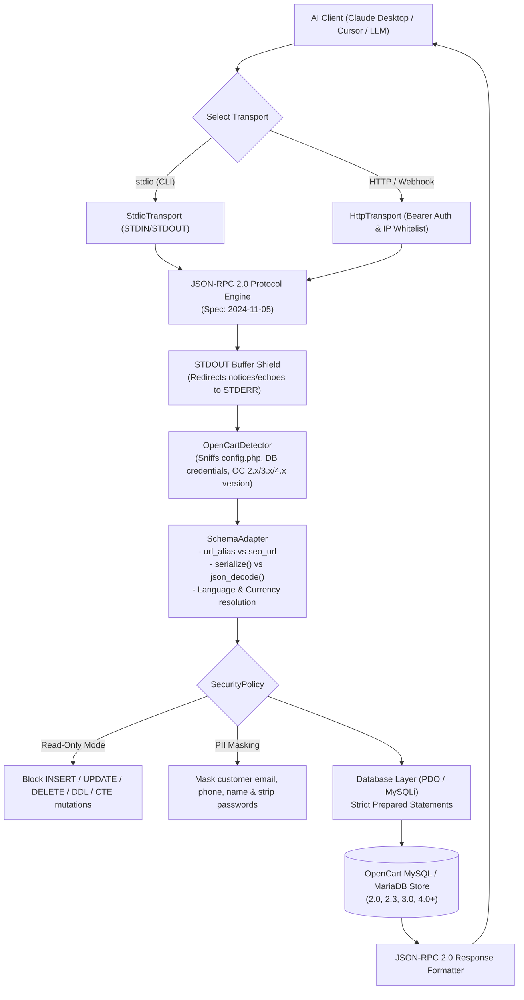

<div align="center">

# 🛒⚡ OpenCart Universal MCP Server

**The Universal, Zero-Dependency Model Context Protocol (MCP) Server for OpenCart 2.0 — 4.0+**

[](https://php.net)
[](https://www.opencart.com)
[](https://modelcontextprotocol.io)
[](#-testing--verification)
[](#-security--reliability-by-design)
[-brightgreen.svg?style=flat-square)](#-architecture--request-pipeline)
[](LICENSE)
[](#-claude-desktop--cursor-configuration)

*Connect any OpenCart store (versions 2.0 through 4.0+) directly to Claude Desktop, Cursor, Gemini, and autonomous AI agents in 30 seconds — with zero modifications to store code.*

[Features](#-why-opencart-universal-mcp) • [Installation](#-installation) • [Quickstart](#-quickstart-in-30-seconds) • [Desktop Config](#-claude-desktop--cursor-configuration) • [Tools Reference](#-mcp-tools-reference) • [Architecture](#-architecture--request-pipeline) • [Security & PII](#-security--reliability-by-design) • [Standalone Bridge](#-standalone-web--cli-bridge) • [Tests](#-testing--verification)

</div>

---

## 🎯 Why OpenCart Universal MCP?

Managing an OpenCart store requires constant manual admin operations: checking low inventory, finding orders, pulling sales metrics, editing prices, and inspecting error logs. 

While other MCP experiments require heavy Python runtimes, support only OpenCart 3.x, charge commercial subscriptions, or require uploading complex OCMOD plugins that crash on legacy stores, **OpenCart Universal MCP** is engineered from the ground up to be:

- 🌐 **Truly Universal OpenCart Compatibility**: Seamlessly handles schema differences between **OpenCart 2.0.x, 2.1.x, 2.2.x, 2.3.x, 3.0.x, and 4.0+** (including ocStore and customized table prefixes like `oc_`).
- ⚡ **Broad PHP Support (PHP 5.4 — 8.4+)**: Runs identically on legacy PHP 5.4 / 5.6 servers and cutting-edge PHP 8.4 environments without syntax errors.
- 🚫 **Zero Store Modifications (No OCMOD Required)**: Connects directly via database or configuration sniffing (`config.php`). You don't have to install or modify a single file in your production store.
- 🛡️ **Safe by Default (Read-Only Mode)**: Write operations (`update_stock`, `update_price`, `update_order_status`) are strictly blocked unless explicitly permitted via `--allow-mutations`.
- 🔒 **GDPR & 152-FZ PII Masking**: Customer emails, telephone numbers, full names, and IP addresses are masked by default when fed into LLM prompts.
- 🔇 **STDOUT Buffer Shield**: Traps legacy PHP notices, warnings, and accidental `var_dump()` output using internal output buffering, routing them to `STDERR` so Claude Desktop never crashes.
- 🔌 **Dual Transport**: Supports standard `stdio` (for Claude Desktop & Cursor) and standalone HTTP POST / Server-Sent Events (SSE).

---

## 🏗️ Architecture & Request Pipeline



---

## 📦 Installation

### Option A: Clone Repository
```bash
git clone https://github.com/Anton-Barinov/OpenCart-MCP.git
cd OpenCart-MCP
```

### Option B: Composer (Optional)
```bash
composer require anton-barinov/opencart-mcp
```

*(Composer is completely optional; the codebase includes a built-in zero-dependency autoloader).*

---

## 🚀 Quickstart in 30 Seconds

### 1. Verify Connection to your Store
Point to your local OpenCart directory:

```bash
php bin/opencart-mcp inspect --root=/var/www/my-opencart-store
```

Output:
```text
=========================================================
  OpenCart Universal MCP Server — Inspection
=========================================================
PHP Version:        8.3.1
Target Root:        /var/www/my-opencart-store
OpenCart Version:   3.0.3.8 [3.x]
Database Driver:    mysqli
Database Host:      localhost:3306
Database Name:      opencart_prod
Table Prefix:       oc_
Database Status:    CONNECTED (OK) ✅
Registered Tools:   17 tools active
Registered Res:     2 resources active
Registered Prompts: 2 prompt templates active
Read-Only Mode:     STRICT READ-ONLY (SAFE) 🛡️
PII Masking:        ENABLED (GDPR/152-FZ) 🔒
=========================================================
```

### 2. Test a Tool from the Terminal
```bash
php bin/opencart-mcp call oc_low_stock_report '{"threshold": 5}'
```

---

## 🖥️ Claude Desktop & Cursor Configuration

### 1. Claude Desktop Setup
Add OpenCart-MCP to `~/Library/Application Support/Claude/claude_desktop_config.json` (macOS) or `%APPDATA%\Claude\claude_desktop_config.json` (Windows):

```json
{
  "mcpServers": {
    "my-store": {
      "command": "php",
      "args": [
        "/absolute/path/to/OpenCart-MCP/bin/opencart-mcp",
        "serve",
        "--root=/absolute/path/to/opencart"
      ]
    }
  }
}
```

*For write operations (updating prices and stock from chat), add `--allow-mutations`:*
```json
"args": [
  "/absolute/path/to/OpenCart-MCP/bin/opencart-mcp",
  "serve",
  "--root=/absolute/path/to/opencart",
  "--allow-mutations"
]
```

Restart Claude Desktop, and your store tools will appear immediately! 🛒

### 2. Cursor IDE Setup
In Cursor Settings -> **Features** -> **MCP Servers** -> **Add New MCP Server**:
- **Name**: `opencart-mcp`
- **Type**: `command`
- **Command**: `php /absolute/path/to/OpenCart-MCP/bin/opencart-mcp serve --root=/absolute/path/to/opencart`

---

## 🛠️ MCP Tools Reference

OpenCart Universal MCP exposes **17 production tools** covering the entire store lifecycle:

### 📦 Products & Catalog
| Tool | Description | Parameters |
| :--- | :--- | :--- |
| `oc_list_products` | Search and filter catalog with pagination | `category_id`, `filter_name`, `filter_status`, `limit`, `offset` |
| `oc_get_product` | Complete product details (prices, attributes, options, SEO URL, images) | `product_id` *(required)* |
| `oc_search_products` | Fast keyword search across product name, model, and SKU | `query` *(required)*, `limit` |
| `oc_update_product_stock` | Update inventory quantity *(Requires `--allow-mutations`)* | `product_id`, `quantity` |
| `oc_update_product_price` | Update product base price *(Requires `--allow-mutations`)* | `product_id`, `price` |

### 🗂️ Categories
| Tool | Description | Parameters |
| :--- | :--- | :--- |
| `oc_list_categories` | List categories with product counts and parent hierarchy | `parent_id`, `limit`, `offset` |
| `oc_get_category_tree` | Retrieve full nested category tree structure | *none* |

### 📑 Orders & Checkout
| Tool | Description | Parameters |
| :--- | :--- | :--- |
| `oc_list_orders` | List orders with status and date filters (PII masked) | `filter_order_status_id`, `filter_date_added`, `limit`, `offset` |
| `oc_get_order` | Get order items, totals breakdown, shipping/payment, and history | `order_id` *(required)* |
| `oc_update_order_status` | Change order status and add history comment *(Requires `--allow-mutations`)* | `order_id`, `order_status_id`, `comment`, `notify` |

### 👥 Customers
| Tool | Description | Parameters |
| :--- | :--- | :--- |
| `oc_list_customers` | List customers with order count and total spent (PII masked) | `filter_name`, `limit`, `offset` |
| `oc_get_customer` | Get customer profile details and saved addresses (PII masked) | `customer_id` *(required)* |

### 📊 Analytics & Inventory
| Tool | Description | Parameters |
| :--- | :--- | :--- |
| `oc_sales_summary` | Revenue, order counts, and average order value breakdown over N days | `days` (default: 30) |
| `oc_low_stock_report` | List products with quantity at or below a threshold | `threshold` (default: 5), `limit` |
| `oc_top_products` | Bestselling products ranked by sales quantity and revenue | `days` (default: 30), `limit` |

### 🔧 System Diagnostics
| Tool | Description | Parameters |
| :--- | :--- | :--- |
| `oc_system_info` | OpenCart version, PHP version, database driver, product/order counts | *none* |
| `oc_read_error_log` | Read the last N lines of OpenCart `error.log` safely | `lines` (default: 50, max: 500) |
| `oc_list_modifications` | List all installed OCMOD modifications and enabled status | *none* |

---

## 🔒 Security & Reliability by Design

1. **Strict Read-Only Mode**: In default configuration, all write operations are actively rejected at the database driver level. Mutating queries (`INSERT`, `UPDATE`, `DELETE`, `DROP`, `ALTER`, `TRUNCATE`, `RENAME`) and CTE mutations throw clean runtime errors.
2. **SQL Injection Immunity**: 100% of queries use parameterized prepared statements through PDO or MySQLi.
3. **Password & Token Stripping**: Customer passwords, salts, and reset tokens are permanently stripped from tool responses.
4. **GDPR / 152-FZ PII Masking**: Customer emails (`cu***@example.com`), phone numbers (`+7 (999) ***-45-67`), names (`I*** D***`), and IP addresses (`192.168.*.*`) are masked before entering LLM context. Pass `--no-mask-pii` only if unmasked data is strictly needed.
5. **STDOUT Isolation**: Legacy PHP applications often trigger notices or unexpected output. OpenCart-MCP wraps every tool execution in an isolated output buffer, safely routing stray output to `STDERR` so the standard I/O JSON-RPC protocol is never corrupted.

---

## 🌐 Standalone Web & CLI Bridge

For remote servers where SSH is not available, upload the single-file bridge:

```bash
# Copy to your server's webroot:
cp standalone/opencart-mcp.php /var/www/my-store/public_html/
```

Access securely over HTTP with a Bearer Token:

```bash
curl -X POST https://my-store.com/opencart-mcp.php \
  -H "Authorization: Bearer my_secret_token_123" \
  -H "Content-Type: application/json" \
  -d '{"jsonrpc": "2.0", "id": 1, "method": "tools/list"}'
```

---

## 🧪 Testing & Verification

Run the full automated test suite:

```bash
php tests/run_tests.php
```

### Test Suites Included (100% Passing):
1. **`DetectorTest.php`**: Validates OpenCart 2.x, 3.x, and 4.x configuration and version auto-detection.
2. **`SecurityTest.php`**: Validates PII masking (names, emails, phones, IPs), token authentication, IP whitelisting, and secret stripping.
3. **`ProtocolTest.php`**: Validates JSON-RPC 2.0 handshake, tool execution, empty batch handling, and STDOUT buffer isolation.
4. **`EndToEndToolsTest.php`**: Seeds an OpenCart database and executes all 17 tools (products, orders, customers, analytics, system diagnostics, and mutation operations).
5. **`RealSitesAuditTest.php`**: Verifies automated configuration detection against live production OpenCart stores.

---

## 🔗 Related Projects in the Ecosystem

- 🤖 **[OpenCart-AI](https://github.com/Anton-Barinov/OpenCart-AI)**: Turn-key OCMOD/vQmod extension with admin UI, 1-click token generator, and built-in e-commerce agent prompts for Claude Desktop and Cursor.
- ⚡ **[PHP-MCP](https://github.com/Anton-Barinov/PHP-MCP)**: Zero-dependency Model Context Protocol framework for PHP 8.1+.
- 🛡️ **[PHP-Hardening-Kit](https://github.com/Anton-Barinov/PHP-Hardening-Kit)**: Universal runtime security shield protecting PHP against zero-days and legacy exploits.
- 📦 **[Single-PHP](https://github.com/Anton-Barinov/Single-PHP)**: Compile PHP code and dependencies into a single standalone executable binary.
- 🐳 **[EOL-PHP-SecAuto](https://github.com/Anton-Barinov/EOL-PHP-SecAuto)**: Automated security patcher & compliance engine for legacy Docker containers.
- 🌲 **[TropaTT](https://github.com/Anton-Barinov/TropaTT)**: Modern open-source CRM, project management, and task engine with native AI agents.

---

## 👤 Author & Support

Maintained with ❤️ by **[Anton Barinov](https://github.com/Anton-Barinov)**.

If this project helps you manage your OpenCart store with AI, please **★ Star the repository** and share it with the community!

## 📄 License

This software is released under the [MIT License](LICENSE).  
Copyright (c) 2026 Anton Barinov.
